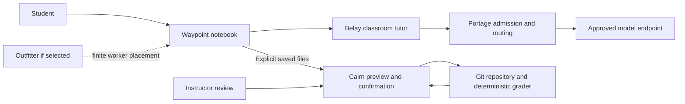

# EduCloud classroom pilot: how the system connects

The INFO 511 NHANES Learning Studio is the current classroom target. It keeps a
familiar notebook/IDE with optional tutoring and explicit saved-file submission.
The research/capstone Inquiry experience and research benchmarking are separate
product lines. Start at the [central status](../../README.md#pilot-status), then
check the [readiness record](../../pilot/readiness.json) before a release.

## Components and responsibilities

| Component | Role in the classroom pilot | Authority |
| --- | --- | --- |
| Waypoint | Notebook, saved workspace, tutor/file-picker entry points and admission | Identity integration, current membership, workspace isolation, fencing, storage and retention |
| belay-classroom | Classroom-specific tutoring and completion reminders | Tutoring policy; explanations never become official grades |
| Portage | Governed inference behind the tutor | Routing, admission, budgets, actual transport requests/retries and usage liabilities |
| Cairn | Assignments, explicit preview/confirmation, repository publication and feedback | Roster/assignment rules, immutable receipts, deterministic checks and instructor review |
| Outfitter | Optional compute placement/lifecycle integration | Reservation identity, original finite deadline, owned-resource cleanup and charges |
| educloud | Shared interfaces, implementation protocol and evidence index | Cross-component decisions and the release record; no runtime authority |

The first four runtime components form the governed notebook-to-tutoring-to-
submission MVP. A maintained single-host workspace does not need a new generalized
broker. Outfitter becomes required when the selected deployment actually uses its
placement service; it is still held to the same development standard. Original
Belay, portage-local, HOST and mobile Wayfare are outside this pilot release line.

## One complete learner journey

1. An approved course identity and current membership admit the learner to an
   isolated Waypoint workspace. The institution/host configuration must establish
   that authority; the local synthetic fixture is not a production login system.
2. The learner edits and runs the NHANES notebook. Saved files remain available
   when AI is off or its finite access window expires.
3. Optional Belay-classroom assistance checks course policy and the explicit
   prediction checkpoint. Portage admits/routes allowed requests and accounts for
   actual requests, retries and unknown usage. A checkpoint reminder is not proof
   of learning, authorship or a grade.
4. The learner selects saved files in Waypoint and transfers them to Cairn using
   the explicit browser handoff. Cairn independently authenticates the course
   account, previews exact bytes and requires confirmation. Theme preferences
   carry no course data or authority; handoff nonces do not replace authentication.
5. Cairn publishes the confirmed files and records the immutable submission
   revision. Changed preview payloads are rejected. Deterministic checks and any
   instructor-reviewed feedback remain visibly distinct. Receipt recovery after
   restart is part of the synthetic acceptance path.
6. Retention/export, backup restoration and resource teardown follow their owning
   component's contract. A successful submission does not prove workspace cleanup
   or settle an uncertain provider charge.

## Contracts, source pins and reproduction

[SYSTEM.md](../../SYSTEM.md) owns shared contracts. The
[component inventory](../../pilot/components.json) records owners, actual workflows
and local/integration verification entry points. The
[common protocol](../development/PILOT_PROTOCOL_V1.md) defines implementation and
handoff requirements. Use component documentation for exact runtime configuration;
this guide is not a second identity, reservation, budget or grading authority.

The current local Studio rehearsal is pinned in
[Waypoint verification v2](https://github.com/EduCloud-Ecosystem/waypoint/blob/9b815043c8ec9162463fcc0ef2d4ef44b86255fe/docs/studio-classic-verification-v2.json)
and its [testing guide](https://github.com/EduCloud-Ecosystem/waypoint/blob/9b815043c8ec9162463fcc0ef2d4ef44b86255fe/docs/studio-classic-testing-v1.md).
Those records distinguish actual synthetic integration, injected UI controls,
failed runs, model transport counts and cleanup. The machine-specific instructor
launcher has `--verify-stub`, `--stub` and separately authorized `--live` modes.
Use the recorded checkout/dependency/image pins; do not substitute latest main and
assume the same result. Never put the provider key in the repository.

The [OpenBao adoption review](OPENBAO_ADOPTION_REVIEW.md) records the optional
local credential-service integration, separate service identity and operator
recovery custody. Default/persistent adoption is pending confirmed institutional
vault import and backup; it does not change the current readiness pins.

## Release and operations

The target AWS host and institutional sign-in remain deployment decisions. The
pilot needs an accepted identity/membership path, approved tutoring destinations
and retention, bounded capacity/spend, secrets management, TLS, backup restore and
rollback rehearsal, expiry/export/cleanup evidence, and human instructor/student
workflow acceptance. Mobile is deferred. No badge or proposal-ready synthetic POC
opens student admission.

For each release record the exact cross-component manifest, migrations and backup
compatibility, deterministic checks, real integration evidence, finite resource
limits, known liabilities, rollback instructions and responsible operator. Recheck
current authority at activation. On failure, preserve learner work, refuse unsafe
new actions, keep receipts/history readable, and expose the recovery state plainly.

## Automated maintenance

The [maintenance guide](../development/MAINTENANCE.md) explains the offline protocol
check and scheduled metadata updater. Agents should use small scoped patches,
locked environments, tests and review. The updater may propose a README/status
snapshot; it cannot change manual readiness, self-merge, spend money or deploy.
